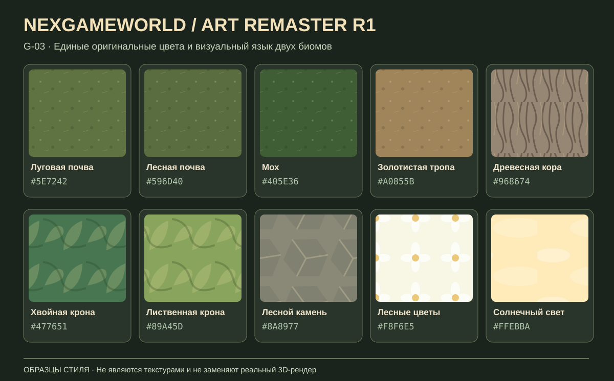

# NGW-ART-REMASTER-001 · G-03 — художественный паспорт R1

**Редакция:** 1.0 · **Дата:** 30.10.2026 · **Область:** действующая сферическая NexGameWorld — стартовая локация, переход и Шепчущий лес.  
**Канонический источник значений для реальной игры:** `planet-test/world-art-style.js` (`ART_STYLE_VERSION = R1-G03-1`).  
**Эталон:** присланное пользователем иллюстративное изображение R1 (30.10.2026). Оно не является кадром работающей 3D-сборки, а содержит художественные ориентиры.  
**Важное решение пользователя:** **не перерабатывать штатную камеру**. Её положение, масштаб, дистанция, наклон, FOV и управление остаются без изменений. Сцену и ассеты подстраивать под уже существующее расположение камеры.

*Образцы авторские, схематические и не заменяют игровые материалы. Источник истины для цветов — модуль `world-art-style.js`; диаграмма показывает читаемость сочетаний и фактур, не точную текстуру альбедо.*

## 1. Стиль и композиция

**Формула R1:** тёплая иллюстративная фэнтези-природа в полноценном трёхмерном мире. Крупные читаемые массы деревьев, тропа как ведущая диагональ, богатая мелкая растительность, чёткий силуэт героя на фоне более тёмных растений; локально золотистое солнце, холодноватые глубокие полутени, выразительная, но не ядовитая зелень.

- **Силуэты.** Лиственные группы — неровные многоярусные лопастные объёмы с просветами. Ель — свисающие разной длины лапы, глубокие промежутки между ними, не геометрический конус. Древесная кора — выразительные вертикальные борозды, корневые утолщения. Никаких одинаковых примитивов, читаемых как шар/цилиндр/треугольник, вблизи.
- **Контраст.** Тень внутри крон насыщенная, но не чёрная; внешние листья заметно светлее; поверхность земли спокойнее растений и героя. Дорога должна читаться как одна тёплая охристая диагональ через обе зоны, а не наклеенная полоса. Никакого выгорания цветов и равномерного глянца.
- **Детализация по расстоянию.** От 0 до 8 м: фактура почвы, коры, листочков папоротника и камушков; 8–25 м: отдельные кроны, группы цветов/кустов и ясные просветы; 25+ м: цельные массы кроны и воздушная глубина без дрожащего «шума». Мастер-ассеты могут быть детальнее массовой модели; оптимизация и LOD — G-39.
- **Плотность.** Растения формируют естественные плотные островки вдоль обочин, а не равномерную сетку; дорожка и игровые цели не должны исчезнуть под травой. На полянах видны короткая трава, земля и цветы; в глубине леса мох, папоротники, листва, грибы, хворост.
- **Масштаб.** Герой по-прежнему маленький на фоне высоких деревьев, но остаётся узнаваемым на текущем штатном зуме. Не увеличивать деревья изменением камеры или серверных хитбоксов.

## 2. Единые цветовые роли

Все значения ниже относятся к `WORLD_ART_PALETTE`; числовые RGB-значения для запечённых грунтовых текстур — **sRGB 8 bit**, цветовые значения Three.js — `#RRGGBB`. Не смешивать случайно нормализованные линейные значения геометрии с 8-битными байтами текстуры.

| Материал / художественная роль | Основной образец | Тень / свет или варианты | Шероховатость, ориентир | Правило |
|---|---|---|---|---|
| Луг и низкая трава | `#5E7242` | `#84804A` | 0.94 | Сдержанный зелёно-оливковый фон, не однотонный ковёр |
| Лесная почва | `#596D40` | `#815E3E` | 0.94 | Зелень мха перемежается гумусом и листовой коричневой подстилкой |
| Мох | `#405E36` | `#47643A`, `#718B4A` | 1.00 | Подкорневые, теневые и влажные островки |
| Тропа | `#A0855B` | `#856C48`, сырые колеи `#494639` | 0.88 | Тёплая охра, неровный край, мягкие солнечные пятна |
| Кора и корни | `#968674` | `#827261`, `#514437` | 1.00 | Тёплые коричнево-серые, никакой чистой холодной серой коры |
| Хвоя | `#477651` | `#355E47`, `#6B915C`, `#507950` | 1.00 | Холодноватая тень нижних ветвей, тёплый свет наверху |
| Листва | `#5C854D` | `#638649`, `#89A45D`, `#628851` | 1.00 | Яркие, но природные светлые края и глубокие внутренние карманы |
| Камень | `#8A8977` | `#6D786B`, `#758177` | 1.00 | Нейтрально-тёплый камень, мягкая зелень от мха |
| Цветы | `#F8F6E5` | `#EEEECF`, `#E8E9FF`, `#E9BF65` | 1.00 | Небольшие белые/кремовые/голубые пятна, не гигантские бутоны |
| Солнце и воздух | `#FFEBBA` | `#A1CCD5`, `#486B70` | Не применимо | Тёплое освещение, прохладный заполняющий свет |

Допустимые отклонения отдельного экземпляра внутри роли: примерно ±10–15% яркости и до 10° оттенка; исключения — грибные шляпки, цветы, вода и квестовые объекты, которые должны различаться. **Нельзя** использовать одну цветовую роль так, чтобы дублирующие ассеты двух биомов имели явно разные цветовые температуры без художественной причины.

## 3. Материалы по технике и масштабу

| Семейство | Устройство поверхности | Взаимодействие со светом | Приёмка |
|---|---|---|---|
| Грунт/тропы | Единые значения цветовых ролей, запечённая слабо повторяющаяся текстура, преимущественно матовая | Тропы получают золотистые блики без металлического блеска | Нет однородных зелёных плоскостей; переход зон плавный |
| Кора | Сильные продольные борозды, поперечные трещины, мох у корней; совместимые albedo и relief | Свет подчеркнёт выступы, трещины остаются тёмными | Стволы обоих биомов читаются вблизи |
| Хвоя и листва | Отдельные группы объёмных листьев/лап; внутри одного семейства общие цветовые роли | Светлая кромка, глубокая внутренняя полутень | Крона не выглядит зелёной пластиковой фигурой |
| Камни | Матовые сколы и небольшие мшистые фасеты | Умеренный холодный рефлекс в тени | Нет синюшных «искусственных камней» возле тёплой тропы |
| Подлесок | Разные формы листа, травы, папоротника, гриба, цветов; общая палитра со старшим пологом | Свет на мелких листьях, теневая читаемость | Богатая флора без потери читаемости цели |

В G-03 **не** создаются заново модели деревьев, объёмные текстуры и глобальная система освещения: это последующие задачи G-06…G-31. Сейчас фиксируются единый стандарт и его реальное подключение к уже существующим материалам обоих биомов.

## 4. Внедрение и зоны ответственности

**Уже подключены к единой палитре в G-03:**
- `landscape.js` — запечённая земля и стартовые дороги;
- `planet-test/forest-ground-texture.js` — лесная почва, влажный мох, лесная подстилка, лесная дорога;
- `start-zone.js` — базовые vertex-оттенки старта;
- `whispering-forest.js` — хвоя, лиственные кроны, кора, корни и свисающий мох;
- `forest-bark-texture.js` — пигмент альбедо коры;
- `sphere-meadow.js`, `forest-ecology.js`, `painterly-biome.js` — базовая трава, кусты, папоротники, декоративные растения и камни;
- `planet.js` — цвет солнца, неба и заполняющего освещения **без изменения мощности источников и положения камеры**;
- `terrain-art-materials.js` — экспериментальная лаборатория материала читает основные образцы этого паспорта.

**Дальнейшие этапы:** G-05…G-10 обновят геометрию/фактуру ландшафта; G-11…G-18 — мастер-форму деревьев; G-19…G-25 — биомную флору; G-26…G-31 — освещение, атмосферу и цветокоррекцию. Всё это должно использовать тот же модуль или обоснованно расширять художественный паспорт.

**Нельзя менять ради палитры:** `state.normal`, управление камерой, HUD, координаты деревьев, коллизии, спавны волков, серверные контракты, состояние персонажей/инвентаря/квестов.

## 5. Визуальное сравнение и приёмка

Открывать четыре контрольных ракурса G-01; G-02 позволяет сохранить настоящие PNG «До/После» и измерения на том же устройстве. Сравнивать объём, цветовую температуру и читаемость **реальной** сцены с R1; не генерировать «псевдоскриншот» как доказательство внедрения.

1. Стартовая зона: земля, растения и освещение принадлежат одной природе со входом в лес.
2. Переход: нет заметной смены тёплой тропы на серую, синюю или ядовито-зелёную.
3. Лес: хвоя, листва, кора, камни и травы сочетаются по палитре в одном кадре.
4. Вся игра: персонаж, UI, взаимодействия и настройки обычной камеры остаются прежними.
5. Репозиторий: тесты подтверждают, что ключевые игровая почва, растения, дерево, солнце и камни импортируют общую палитру; коды и визуальные образцы согласованы.
6. Реальный iPhone Safari: финальная художественная приёмка требует проверки пользователя. Успешный CI без такого просмотра не доказывает точного сходства с R1.

## 6. Журнал решений

- **R1-G03-1:** единый стиль без сторонних игровых ресурсов; исходная композиция и геймплей сохраняются.
- **R1-G03-1:** все палитры централизованы в `world-art-style.js`. Цветовая разница между участками допускается как естественное проявление освещения/влажности, но не как несовместимый стиль.
- **R1-G03-1:** прежняя камера сохраняется полностью по прямому решению пользователя от 30.10.2026.
